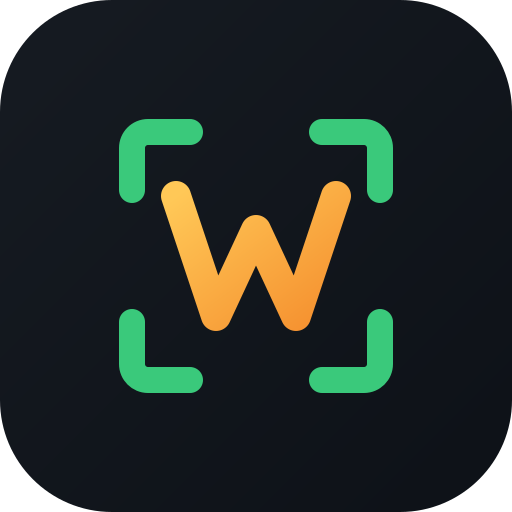

<p align="center">
  
</p>

<h1 align="center">ShareW</h1>

<p align="center">
  <b>English</b> | <a href="README.ru.md">Русский</a>
</p>

<p align="center">
  
  
  
  <a href="LICENSE"></a>
  
</p>

---

ShareW is a screenshot and annotation tool for Wayland in the spirit of ShareX. Capture a region, a window or a whole screen, mark it up, and send it where you need it, on any compositor and window manager: Sway, Hyprland, river, niri, KDE, GNOME and others.

> **Status: early development.** A working base exists: capture through `xdg-desktop-portal`, region selection and a simple editor (pen, line, arrow, rectangle, ellipse, text, undo / redo, copy and save). Everything else below is still a plan.

## Planned features

**Capture**

- Region, window, full screen and single monitor
- Delay timer and "repeat last region"
- Freeze-frame region selection with a magnifier and pixel-precise handles
- Optional screen recording (GIF / WebM) after the screenshot features are stable

**Editor**

- Pen, highlighter, line, arrow, rectangle, ellipse
- Text with font, size, color and outline
- Numbered step markers
- Blur, pixelate and spotlight for hiding or focusing on parts of the image
- Color picker, crop, undo / redo

**After capture**

- Copy to clipboard (`wl-clipboard` compatible)
- Save to a configurable folder and filename template
- Upload to custom HTTP endpoints, with the result URL copied to the clipboard
- Tray icon and notification with quick actions
- History of recent captures

**Integration**

- Runs as a regular app with a CLI: `shareW region`, `shareW screen`, `shareW window`
- Bind the commands to keys in your compositor config, no global-shortcut support required from ShareW itself
- No dependency on a specific desktop environment

## How it will work on Wayland

Wayland deliberately does not let a client read other windows or the screen, so ShareW uses the standard ways of asking the compositor:

| Method | Used when |
| --- | --- |
| `xdg-desktop-portal` Screenshot / ScreenCast | GNOME, KDE and other compositors with a portal backend |
| `ext-image-copy-capture-v1` / `wlr-screencopy-unstable-v1` | wlroots-based compositors and others that implement the protocol |
| `wlr-layer-shell` | Overlay for region selection on compositors that support it |

The backend is picked automatically and can be forced in the config. If a compositor supports none of these, ShareW cannot capture on it. That is a Wayland limitation, not something to work around.

## Technical overview

- C++20, Qt 6 (Widgets) for the UI and the editor, CMake as the build system
- Capture backends are separate from the UI and sit behind one interface, so adding a new one does not touch the editor
- The editor keeps annotations as objects until export, so they stay editable and undo / redo is cheap
- Settings are stored in `~/.config/shareW/config.ini`

## Build

Requires Qt 6 (Base, Widgets, DBus) and CMake 3.20+:

```
cmake -S . -B build
cmake --build build -j"$(nproc)"
```

Run `./build/shareW` (full screen) or `./build/shareW region` (region). The `window` mode is not implemented yet.

## Roadmap

1. Full-screen and region capture on wlroots compositors
2. Portal backend for GNOME and KDE
3. Editor: pen, shapes, arrows, text
4. Blur / pixelate, step markers, clipboard and file output
5. Uploaders, history, tray
6. Screen recording

Ideas and pull requests are welcome.

## License

BSD 3-Clause, see [`LICENSE`](LICENSE).
